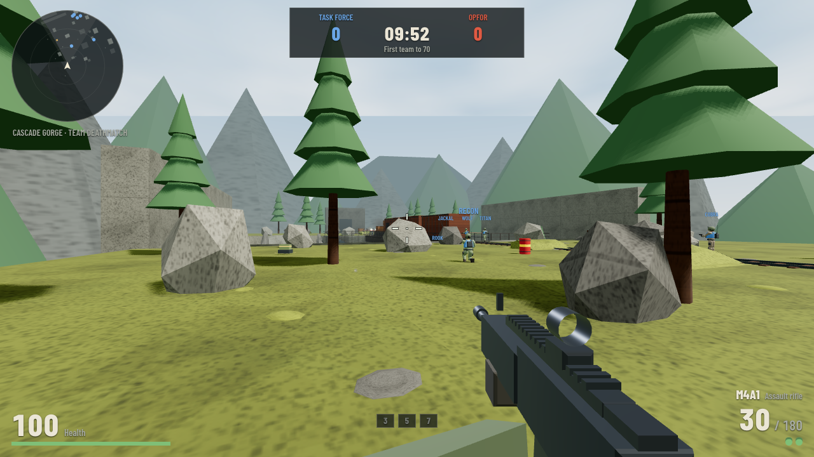
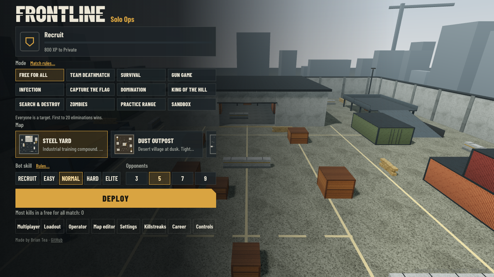
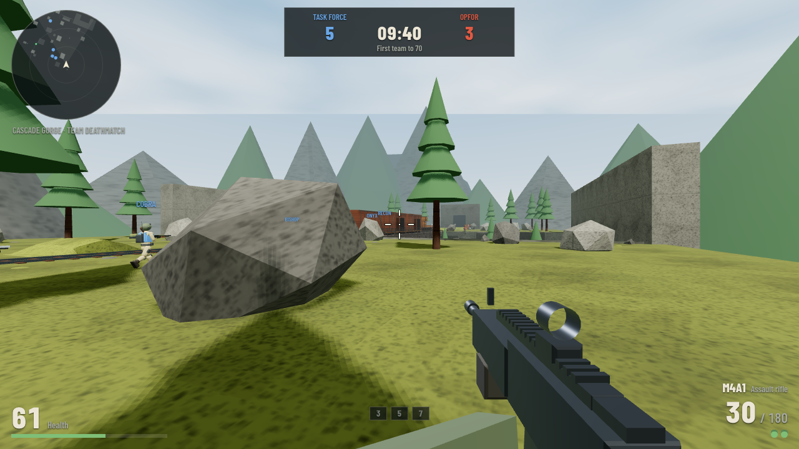

# Frontline: Solo Ops

**A first-person shooter that runs in your browser: no install, no account, no game server.**
Inspired by Combat Arms, with some Halo and Call of Duty mixed in.

### [▶ Play it now: frontline-squad.netlify.app](https://frontline-squad.netlify.app)



| | |
| --- | --- |
|  |  |

Desktop browser with a mouse and keyboard. Press **Controls** in the main menu for the key bindings.

## Highlights

- **13 modes:** Free for All, Team Deathmatch, Domination, King of the Hill, Search & Destroy, Capture the Flag, Gun Game, Infection, Survival, Zombies (co-op), Practice Range, Sandbox, plus a lobby warm-up.
- **9 maps**, including Cascade Gorge (canyon, rail bridge with a freight train), Harbour, Snowbound Radar Base and a night variant of Atomic Acres. An **in-game map editor** lets you build your own (export/import as JSON).
- **17 guns and a knife,** attachments, power weapons, grenades, killstreaks, ranks and medals, and four drivable or flyable vehicles (jeep, helicopter, ATV, Kestrel attack flyer).
- **Multiplayer for up to 12 players,** peer to peer over WebRTC. Invite links, ready-up, in-match chat and votes, host migration, spectating, and join-in-progress.
- **Bots** with skill levels 1 to 10 that patrol, flank, take cover, throw grenades and play every objective.
- **Everything is generated in code:** all art, audio and music. The whole game ships as **one self-contained HTML file (about 1.3 MB)** that also works offline.

## How it works

- **Engine:** three.js (r128) with a custom game loop, collision, bot pathfinding and netcode. No game framework.
- **Collision and bots:** maps are data. They are merged into a few meshes plus axis-aligned colliders in a spatial hash. A 2 m navigation grid drives A* pathfinding, which runs on a Web Worker.
- **Multiplayer:** the host is the referee. Anything with consequences (damage, deaths, rewards, rounds) has exactly one owner, the host, and joiners mirror it. Joiners move and shoot locally so there is no input lag, and the host checks their hit claims. Rooms connect directly when possible and fall back to a free relay. No server of mine is involved, only a free public matchmaking broker and STUN/TURN servers.
- **Build:** a Vite project in `src/`, bundled into the single HTML file by `scripts/build-standalone.mjs` (esbuild).
- **Tests:** 68 headless-Chromium (Playwright) test scripts cover every mode on every map, multiplayer with 2 to 16 simulated pages, screen fit at four resolutions, a visual-vs-collider audit of every map, spawn separation, vehicles and the editor.

Deeper dives: [architecture](docs/ARCHITECTURE.md) · [decisions and roadmap](docs/ONE_PAGER.md) · [full build log](PLAN.md) · [test guide](tests/README.md)

## Run it locally

```bash
npm install
npm run dev               # dev server with hot reload
npm run build:standalone  # one HTML file in dist-standalone/
```

You can also open `dist-standalone/frontline_solo_ops.html` directly in any modern desktop browser.

Run the tests (the smoke suite takes about 15 seconds on an Apple Silicon Mac):

```bash
npx playwright install chromium   # one time
sh tests/setup.sh                 # one time
sh tests/quick.sh
```

## Playing multiplayer

1. Click **Multiplayer**, type a name, then **Host a game**. Share the room code or click **Copy invite link**.
2. Friends open the link (or type the code), click **Ready**, and the host clicks **Start match**.
3. If a code can't reach the matchmaking server, use the copy-paste codes in the lobby, which work with no server at all, even on a LAN.

Everyone needs the same version of the game, so reload the page if you can't connect. Progress (XP, ranks, loadouts) is saved in your own browser. **Career → Export** moves it to another computer.

## How I built this

I directed this project and Claude (Anthropic) wrote most of the code. I set the vision, played every build, and decided what to keep, cut and fix. The first 98 commits are authored by Claude in a claude.ai session, and the repo moved to Claude Code afterward. Two habits kept it from turning into AI slop:

- **Every fix gets a test.** The test suite is the safety net that let me keep changing a codebase I did not type line by line.
- **Audits over spot checks.** Writing a test that checks every map found invisible wall gaps nobody had reported, and a spawn audit caught soldiers spawning inside each other.

[`CLAUDE.md`](CLAUDE.md) records the project's rules and pitfalls for the AI. [`PLAN.md`](PLAN.md) is the item-by-item log, and [`docs/ONE_PAGER.md`](docs/ONE_PAGER.md) records key decisions and what building it taught me.

## Status

It's a hobby project that is playable and tested but not finished. Known issues and ideas for what's next are tracked in [`PLAN.md`](PLAN.md).

## Made by

**Brian Tea** · [Portfolio](https://briantea.vercel.app) · [GitHub](https://github.com/branmuffn) · Licensed under the [MIT License](LICENSE).
