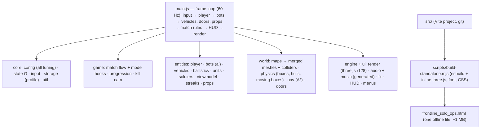

# Frontline: Solo Ops — Architecture and Status

Status as of 2026-11-04: Rounds A and B, Phases 1–7 (7a co-op, 7b versus, 7c up to 8 players with ready-up, kick, chat, skins, ping) and extras are built and tested, plus bot skill 1–10 and bot rules, joiner killstreaks, joiner kill cam with slow-mo, killable vehicle crews and vehicles in multiplayer. Decisions in `PLAN.md`; roadmap in `docs/ONE_PAGER.md`.

## How a frame flows

## Key design points

- One shared state object `G` (src/core/state.js); `window.__frontline` exposes internals for tests.
- Static colliders are AABBs in a spatial hash; convex props add exact hull colliders for bullets (`hull`, `rayOnly`) and fitted movement boxes (`noRay`). Vehicles and doors are moving oriented boxes in `G.world.dynamic`.
- Bots: perception → state machine → A* on a 2 m nav grid with ladder links; vehicle crews in `entities/vehicles.js` (`botVehicle`).
- Soldiers: one SkinnedMesh each (vertex colours, far LOD, cached geometry), bones driven by `poseSoldier`, IK hands.
- Modes plug into `game/match.js` through hooks (`game/modes.js`).
- All audio and music are generated with Web Audio; no external assets or requests.

## Multiplayer (src/net)

- `transport.js`: `Link` = reliable channel (events) + unreliable `fast` channel (snapshots, states). Room codes through the PeerJS cloud broker (bundled) + Google STUN; manual copy-paste offer/answer codes (deflate + base64) need no server.
- `net.js`: session `G.mp`. Host runs everything; each joiner is a `remote` unit (soldier, no brain) driven by its 30 Hz state. Clients run their own player locally, render other units as `proxy` units interpolated 100 ms back, and claim their own non-explosive hits (`G.mp.clientDamage`); the host applies claims (`info.claim`) and ignores mirrored shots. Explosives, pickups, barrels, doors, drops, deaths, respawns and Zombies purchases are host-decided. Hooks in game code are guarded by `G.mp && G.mp.live`.
- `netveh.js`: vehicles in MP (joiner-driven pose streaming, host-assigned seats, interpolation, hull-hit claims).
- Relay: PeerJS's free TURN relay is always offered after Google STUN, plus an optional own relay (localStorage `frontline_mp_v1.turn`).
- `lobby.js`: Multiplayer screen. Test: `tests/mp.mjs` (two pages, manual codes, fake clock).

## Build, outputs, document control

| Output | Made by | Purpose |
| --- | --- | --- |
| `src/` + `index.html` | hand-written, one git commit per item | source of truth; `npx vite` (dev), `npx vite build` |
| `dist-standalone/frontline_solo_ops.html` | `node scripts/build-standalone.mjs` | play offline, share, publish |
| `frontline-solo-ops-vite.zip` | `sh tests/ship.sh "msg"` | archive: source, tests, docs, git history |

`tests/ship.sh` builds both, commits, copies the HTML and zip to the outputs folder and updates the artifact. Keep the zip as the master record; the HTML can always be regenerated from it. Decisions: `PLAN.md`; playing/building: `README.md`; tests: `tests/README.md`.

## Rev 4 additions (where things live)
- `src/engine/power.js` perf readout counters, battery prompt, persistent storage, backup reminder; presets in `core/storage.js` (QUALITY).
- `src/game/objectives.js` Domination / King of the Hill / Search & Destroy hooks (objective points from spawns or `def.objectives`).
- `src/game/modes.js` hooks for Gun Game, Infection, CTF, Zombies (difficulty, revives), Practice range (rack, drills).
- `src/game/editor.js` + `src/world/maps/custommap.js` map editor (localStorage `frontline_custom_map`, JSON export/import).
- `src/world/navworker.js` A* in a blob Web Worker (off under the test harness; sync fallback after 0.4 s).
- `src/engine/merge.js` mergeStatic (batched vehicle bodies). `src/ui/ping.js` pings. Votes live in `src/net/net.js`.
- Vehicles: `SPEC` in `src/entities/vehicles.js` (jeep, heli, atv, kestrel; `spec.fly`, `spec.tail`, `spec.mesh()`).
- Power weapons + attachments: `POWER`, `ATTACH`, `withAttachments` in `core/config.js`; spawns in `game/match.js`.
