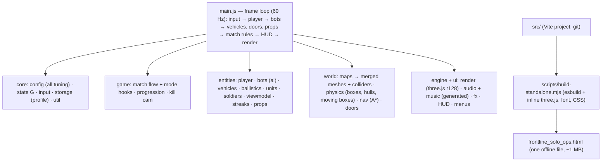

# Frontline: Solo Ops — Architecture and Status

Status as of 2026-11-03: Rounds A and B, Phases 1–6 and extras X1–X2 are built and tested. Phase 7 (multiplayer) waits for approval; its decisions are in `PLAN.md`.

## How a frame flows

## Key design points

- One shared state object `G` (src/core/state.js); `window.__frontline` exposes internals for tests.
- Static colliders are AABBs in a spatial hash; convex props add exact hull colliders for bullets (`hull`, `rayOnly`) and fitted movement boxes (`noRay`). Vehicles and doors are moving oriented boxes in `G.world.dynamic`.
- Bots: perception → state machine → A* on a 2 m nav grid with ladder links; vehicle crews in `entities/vehicles.js` (`botVehicle`).
- Soldiers: one SkinnedMesh each (vertex colours, far LOD, cached geometry), bones driven by `poseSoldier`, IK hands.
- Modes plug into `game/match.js` through hooks (`game/modes.js`).
- All audio and music are generated with Web Audio; no external assets or requests.

## Build, outputs, document control

| Output | Made by | Purpose |
| --- | --- | --- |
| `src/` + `index.html` | hand-written, one git commit per item | source of truth; `npx vite` (dev), `npx vite build` |
| `dist-standalone/frontline_solo_ops.html` | `node scripts/build-standalone.mjs` | play offline, share, publish |
| `frontline-solo-ops-vite.zip` | `sh tests/ship.sh "msg"` | archive: source, tests, docs, git history |

`tests/ship.sh` builds both, commits, copies the HTML and zip to the outputs folder and updates the artifact. Keep the zip as the master record; the HTML can always be regenerated from it. Decisions: `PLAN.md`; playing/building: `README.md`; tests: `tests/README.md`.
