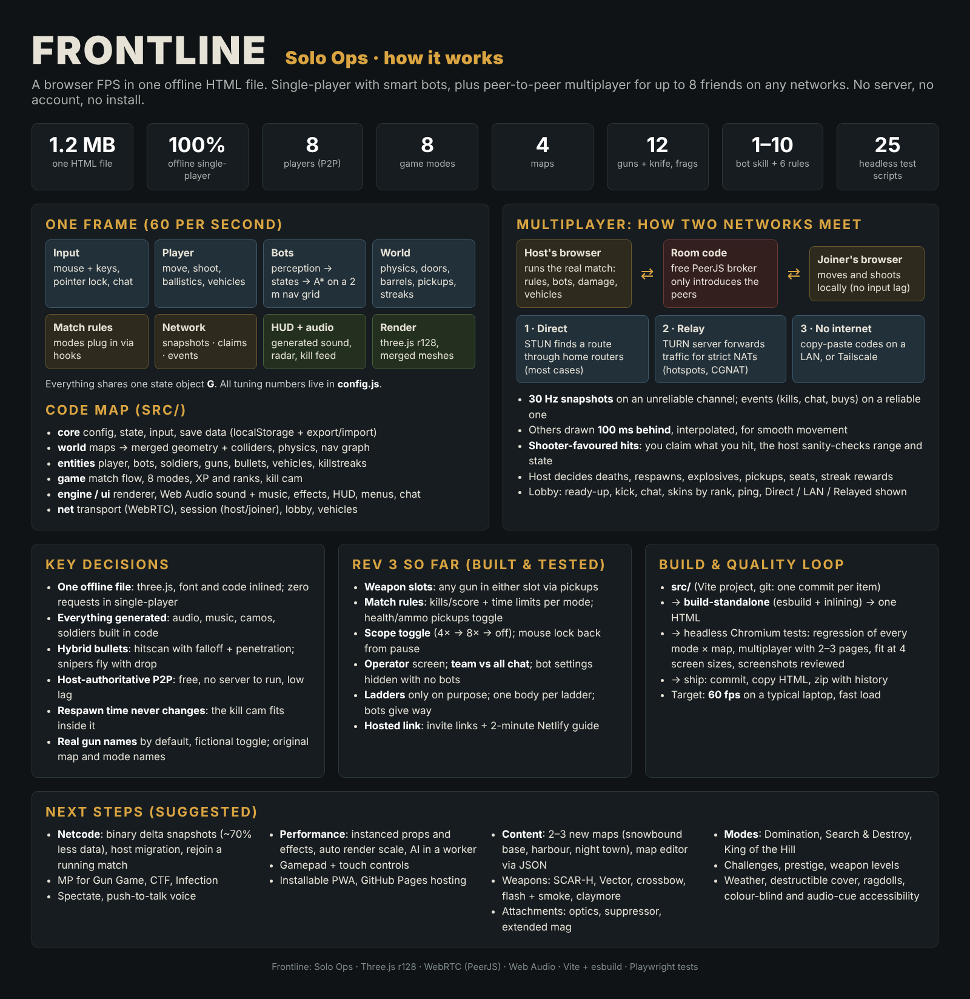

# Frontline: Solo Ops — one-pager

## What it is
A browser FPS delivered as one self-contained HTML file (~1.2 MB): three.js r128, the game code and a font are inlined, so single-player runs with no network at all. Multiplayer (up to 8 players) is peer to peer over WebRTC; the only outside services are a free matchmaking broker (room codes) and public STUN/TURN servers that help two networks find each other.

## How it is built
- **Source:** a Vite project in `src/` (core, world, entities, game, engine, ui, net). One shared state object `G`; every balance number lives in `src/core/config.js`.
- **Frame loop (60 Hz):** input → player → bots → network → physics clean-up → grenades, rockets, bullets, props, vehicles, doors, pickups, killstreaks → HUD → kill cam recording → render.
- **World:** maps are data (boxes, ramps, props) merged into a few meshes plus axis-aligned colliders in a spatial hash, exact convex hulls for round props, oriented boxes for vehicles and doors. A 2 m nav grid with ladder links drives bot A*.
- **Build:** `scripts/build-standalone.mjs` (esbuild + inlining) → `dist-standalone/frontline_solo_ops.html`. `tests/ship.sh` builds, commits, copies to outputs and zips the repo with its git history.
- **Quality loop:** 25 headless Chromium test scripts (regression of every mode × map, 2- and 3-page multiplayer, screens fit at 4 sizes, screenshots reviewed by eye).

## Key decisions and why
| Decision | Why |
| --- | --- |
| One offline HTML file | Share it like a document; works on a plane; nothing to host or keep alive. |
| All audio, music and art generated in code | No asset licensing, tiny download, consistent style. |
| Hybrid bullets (hitscan + falloff + penetration; snipers fly with drop) | Arcade feel for most guns, skill ceiling for snipers, cheap to compute. |
| Host-authoritative peer to peer | Free, no server to run; the host's game is the referee. |
| Joiners move/shoot/drive locally and claim hits | No input lag for anyone; the host sanity-checks range, state and timing. |
| Others drawn 100 ms in the past, interpolated | Smooth movement despite 30 Hz snapshots and jitter. |
| Free TURN relay after STUN | Different Wi-Fi networks connect even behind strict NATs (hotspots, CGNAT). |
| Respawn time never changes for the kill cam | Fairness: the replay (incl. slow-mo) is fitted into the existing delay. |
| Bot skill 1–10 interpolated between named anchors | One slider covers Recruit to Elite without hand-tuning 10 profiles. |
| Real gun names by default, fictional toggle; original maps/modes | Familiar feel without using anyone's brand names. |

## Insights from building it
- Most multiplayer bugs were "who decides?" bugs: anything with consequences (damage, deaths, streak rewards, seats) must have exactly one owner (the host); everything else is a mirror.
- Mirrors must include visuals, not just results: joiners used to take damage from mortars and sentries they could not see.
- Overriding a library's network config can silently remove its fallbacks (the custom STUN list dropped PeerJS's TURN relay).
- Tests that need real time (chat rate limits, reconnects) must use the same fake clock the game uses.
- Collision volumes double as armour: a vehicle box that fully encloses its crew made them unkillable until rounds were allowed through the hull.

## Rev 3 progress
Done: Standard weapon slots (rifle + sniper via pickups), match limits per mode (SP + MP), health/ammo pickups toggle, scope toggle, "Use mouse lock again", Operator screen, team vs all chat, bot settings hidden with no bots, intentional ladders with blocking and bots giving way, invite links and hosting guide (docs/HOSTING.md).
Gorge rework part 1 done: metal zig-zag stairs, slide chutes (walk backwards to brake; steep middle is lethal), staggered ledges, berms and bushes to hide in, bigger boxcar roof hatches, shorter train ladder.
Also done: version label on menu + lobby (warns when a friend is on another build), rolling ridges and ground texture on Gorge, AK viewmodel fix.
Next: viewmodel fix, helicopter targets, game-ending replay, frame-rate limit, then 3b loadout & gear (incl. female operators), 3c medals + adjustable killstreaks + practice range, 3d netcode, 3e modes & weapons, 3f maps, vehicles, performance.

## Roadmap: suggested improvements
**Multiplayer and netcode**
1. Binary snapshots with delta compression (ArrayBuffer instead of JSON): ~70% less bandwidth, better on weak Wi-Fi.
2. Host migration and rejoin-in-progress (today a host leaving ends the match).
3. Multiplayer for Gun Game, Capture the Flag and Infection (hooks exist; needs state mirroring).
4. Spectator mode, push-to-talk voice over the existing WebRTC link, team-only chat.
5. Optional tiny self-hosted signalling server for people who prefer not to rely on the public broker.

**Performance**
6. Instanced meshes for props, bullet holes and particles; texture atlasing; fewer draw calls on big maps.
7. Automatic render scale to hold 60 fps on weak laptops; frame-time budget per system.
8. Move bot perception and A* to a Web Worker when bot counts grow.

**Gameplay and content**
9. New maps: a snowbound radar base, a harbour with cranes and ships, a night variant of Atomic Acres; a JSON map editor/import.
10. New weapons: battle rifle (SCAR-H), PDW (Vector), crossbow, flashbang, smoke, claymore, riot shield.
11. Attachments (optics, suppressor, extended mag, grip) with unlocks per weapon level.
12. Modes: Domination, Search & Destroy, King of the Hill; daily challenges, prestige.
13. More killstreaks: care package, attack helicopter (AI), counter-UAV.
14. Weather (rain, fog), destructible cover, simple ragdolls.

**Reach and usability**
15. Gamepad and touch controls; installable PWA; GitHub Pages hosting for a shareable link.
16. Accessibility: colour-blind team colours, on-screen cues for important sounds, subtitle-style kill feed sizing.
17. A practice range with target dummies and damage numbers for learning recoil and falloff.
